<h1 align="center"></h1>

<table>
  <tr>
    <td width="25%" align="center"></td>
    <td width="75%">
      <strong>Sushil · XTREME</strong> 
      Technical art · Game design &amp; programming · C++ · C# 
      Web development · API · QA &amp; test automation  
      <a href="https://github.com/Sushil045?tab=repositories">Browse repositories</a> · <a href="https://github.com/Sushil045#js-contribution-activity">GitHub activity</a>
    </td>
  </tr>
</table>

## Featured projects

| Project | What I worked on |
| :-- | :-- |
| **Dofida** | A cinematic web portfolio built with React and TypeScript, with a custom GLSL nebula and scroll-driven scenes. |
| **[Utkarsh Barethiya’s cybersecurity portfolio](https://utkarsh-security-portfolio.sushilpawle123.chatgpt.site)** | A site I built to showcase Utkarsh’s cybersecurity work. |
| **Abhi’s portfolio** | A portfolio website I built for Abhi. |
| **Crypto Wallet** | A software project exploring cryptocurrency wallets. |

## About me

I'm Sushil, and I go by **XTREME** here. I'm learning how games go from an idea to something you can play, from game design and programming to technical art. I'm also pursuing web development and quality assurance (QA).

**Global Step** · Game testing internship

## Skills

| Area | Focus |
| :-- | :-- |
| **Games** | Technical art, game design, game programming, C++, C# |
| **Web** | Web development, UI/UX, API work on Dofida |
| **QA** | Game testing, quality assurance, test automation |
